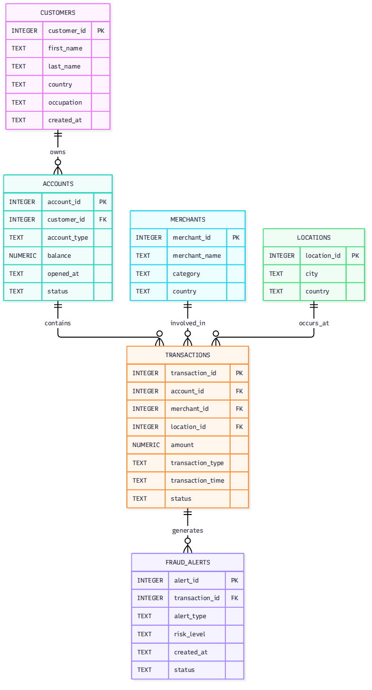

# Design Document
By Sahar Setaiesh

Video overview: https://youtu.be/SgOXP270zv8

## Scope

The purpose of this database is to organize and analyze financial transaction data in order to identify potentially suspicious activity. The database is designed as a financial fraud monitoring system that helps investigators find transactions that may require further review.

The database represents customers, their financial accounts, merchants, transaction locations, financial transactions, and fraud alerts. Customers can have multiple accounts, and each account can have multiple transactions. Transactions may be associated with merchants and locations. Potentially suspicious transactions can generate one or more fraud alerts with different risk levels and investigation statuses.

The database is intended to support common financial monitoring tasks such as finding unusually large transactions, identifying accounts with high transaction activity, analyzing fraud alerts by risk level, and identifying merchants or customers associated with suspicious activity.

Outside the scope of this database are actual banking operations, money transfers between real financial institutions, authentication, customer communication, regulatory reporting, and real-time fraud prevention. The database also does not attempt to prove that a transaction is fraudulent. Instead, it identifies potentially suspicious activity according to predefined rules so that it can be reviewed by a human investigator.

## Functional Requirements

A user should be able to store and retrieve information about customers, accounts, merchants, locations, and financial transactions. Users should also be able to create and review fraud alerts associated with potentially suspicious transactions.

The database supports queries for large transactions, high-risk alerts, customers associated with suspicious activity, merchants associated with fraud alerts, and accounts with unusually high transaction activity. A view named `suspicious_transactions` provides investigators with a convenient way to review medium- and high-risk transactions together with customer and alert information.

The database is not intended to automatically determine whether fraud has occurred. It does not use machine learning, external credit information, real-time transaction monitoring, or external financial institutions. Its purpose is to organize information and support investigation rather than replace professional judgment.

## Representation

### Entities

The database contains six primary entities: customers, accounts, merchants, locations, transactions, and fraud alerts.

The `customers` table represents people who use financial accounts. It stores a unique customer ID, first and last names, country, occupation, and the date the customer was added to the system. Text fields are used for names, country, and occupation because these values are descriptive rather than numerical.

The `accounts` table represents financial accounts belonging to customers. Each account has a unique ID and a foreign key referencing its customer. The account type is restricted to Checking, Savings, or Credit using a CHECK constraint. The balance is stored as a numeric value and cannot be negative. Account status is restricted to Active, Frozen, or Closed.

The `merchants` table represents businesses involved in transactions. Each merchant has a unique ID, name, category, and country. These fields allow transactions to be analyzed by merchant and geographic information.

The `locations` table represents locations where transactions occur. Each location has a unique ID, city, and country. Keeping locations in a separate table avoids repeatedly storing the same geographic information in the transactions table.

The `transactions` table represents individual financial transactions. Each transaction references an account and location and may optionally reference a merchant. The transaction amount must be greater than zero. Transaction types are restricted to Purchase, Transfer, Withdrawal, or Deposit, while transaction status is restricted to Completed, Pending, or Declined.

The `fraud_alerts` table represents potential warning signals associated with transactions. Each alert references a transaction and includes an alert type, risk level, creation time, and investigation status. Risk level is restricted to Low, Medium, or High.

### Relationships

A customer can have multiple accounts, but each account belongs to one customer. Therefore, the relationship between customers and accounts is one-to-many.

An account can have many transactions, while each transaction belongs to one account. This creates a one-to-many relationship between accounts and transactions.

A merchant can be associated with many transactions, while a transaction can reference zero or one merchant. This allows transactions such as withdrawals or transfers that may not involve a merchant.

A location can be associated with many transactions, while each transaction has one recorded location.

A transaction can generate multiple fraud alerts. This allows a single transaction to trigger different warning signals, such as a large amount and rapid transaction activity.

Foreign keys are used to maintain referential integrity between related entities. NOT NULL constraints are applied to fields that are required for meaningful records, while CHECK constraints restrict fields to valid predefined values.

## Optimizations

Several indexes were created to improve common queries used for financial monitoring.

An index on `transactions.account_id` improves searches for transactions belonging to a particular account. An index on `transactions.transaction_time` supports queries involving transaction dates and times. An index on `transactions.amount` helps with searches for unusually large transactions.

An index on `fraud_alerts.risk_level` improves queries that filter alerts by risk level, particularly when investigators need to focus on high-risk activity.

The database also includes the `suspicious_transactions` view. This view joins transactions, accounts, customers, and fraud alerts and returns medium- and high-risk activity in a convenient format. Using a view avoids repeatedly writing the same joins when investigators need to review suspicious transactions.

## Limitations

This database is a simplified model of financial fraud monitoring. It does not represent the complete complexity of a real banking system.

The system relies on predefined rules and stored fraud alerts. It does not use machine learning or behavioral models to discover previously unknown fraud patterns. It also does not connect to external banking systems, credit bureaus, payment networks, or real-time transaction feeds.

The database records transaction locations, but it does not model detailed geographic information such as GPS coordinates or travel time between locations. Therefore, it cannot reliably determine whether a customer could physically move between two transaction locations within a particular period.

The database also does not represent every possible financial product, regulatory requirement, or banking process. Fraud alerts are indicators for investigation and should not be interpreted as proof that fraudulent activity has occurred.

